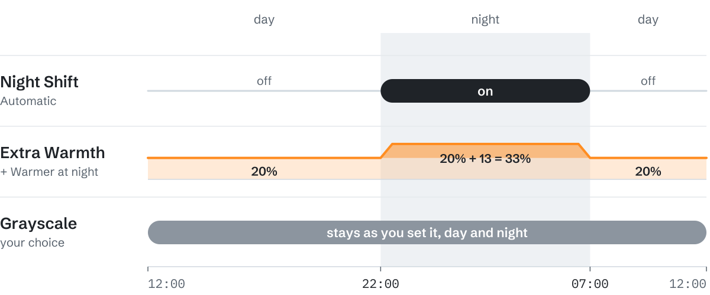

# Night Shift and warmth

Night Shift is the macOS feature that warms the screen in the evening. Extra Warmth is Less Pull's own slider, which goes further, through amber to red, at any hour. **Warmer at night** adds a few points of Extra Warmth for the night, and Night Shift on **Automatic** keeps the same night.

  <picture>
    <source media="(prefers-color-scheme: dark)" srcset="assets/nightshift-dark.svg">
    
  </picture>

An example: the night from 22:00 to 07:00, Extra Warmth at 20%, Warmer at night at +13.

## The night

You set it once, under **Settings… → General → Night schedule**:

- **Sunset to sunrise** follows the sun where you are.
- **Custom hours** uses the hours you pick. New installs start at 22:00 to 07:00.

It is one schedule with macOS: Less Pull writes it into the Night Shift schedule (System Settings → Displays → Night Shift…), and a change made there comes back to Less Pull.

macOS keeps **Sunset to sunrise** only when it may use your location for the time zone: Location Services on, with **Setting time zone** allowed under System Services, and **Set time zone automatically** on under General → Date & Time. Until then, Less Pull works out sunset and sunrise from your time zone and switches Night Shift itself. The note under Night schedule says so and has a button for each setting.

## Warmer at night

At night, Less Pull adds this many points to your Extra Warmth, and takes them away again in the morning. The extra warmth rises over the first half hour of the night and fades over the last.

- **Off** adds nothing: the slider's warmth stays the same day and night.
- **A number of points** adds that much: pick one from the list (+5 to +50) or type your own. New installs start at +13.
- **Red** makes the night red, whatever the warmth by day.
- **Try it** shows the night look for a minute, long enough to switch to other apps and see it there. Click again to end it sooner. Unless Night Shift is set to Off, it comes on for that minute too.

At night, the slider's title in the menu says so: **Extra Warmth · +13 at night**.

Apps and websites with their own warmth keep exactly that warmth, at night too. Grayscale is not affected; it stays the way you set it, day and night.

## Night Shift: Automatic, On or Off

- **Automatic** is on at night and off by day, on the night above.
- **On** and **Off** hold until you change them.
- The menu has the same choice in its **Night Shift** row, as **Auto | On | Off**, with a word for whether Night Shift is on right now.

To turn Night Shift off for a while, choose **Night Shift off for** in the menu: **Off for 1 hour**, **Off for 4 hours**, or **Off until morning**.

- When the time is up, Night Shift comes back if it should be on at that hour. On Automatic that means only at night; it is never forced on in the daytime.
- A timed off wins over an app exception that says Night Shift: On.
- **Pause Less Pull** is different: it shows the plain display for a while and leaves Night Shift alone.
- Quitting Less Pull removes the warmth it added and ends a timed off safely.

## The lock screen and screensaver

Less Pull's warmth cannot reach the lock screen or the screensaver, so Night Shift takes over there: while Less Pull is quieting your screen (Grayscale or warmth on), it turns Night Shift on at full warmth, and everything returns as it was when you are back. Your schedule stays as it is. The choices are in **Settings… → General** once **Show advanced options** is on.

## Coming from an earlier build

Build 41 and earlier had **Extra Warmth follows Night Shift**. Your setup carries over, so the screen looks as it did:

- With following on, your warmth became the amount for **Warmer at night**, and Extra Warmth by day is Off.
- With following off, your warmth stays all day, and Warmer at night is Off.
- Night Shift keeps its schedule: with a macOS schedule it becomes **Automatic** on that schedule; without one, **On** or **Off** as it was.

## Limits

- The Extra Warmth percentage is a relative control. It is not a Kelvin value and not a measured reduction in blue light.
- Some displays, HDR modes and other display tools can stop Night Shift from taking effect. **Settings… → About → Diagnostics…** shows what Less Pull requested and what macOS reported.
- Less Pull is not a medical device and makes no promises about sleep or eye health.
